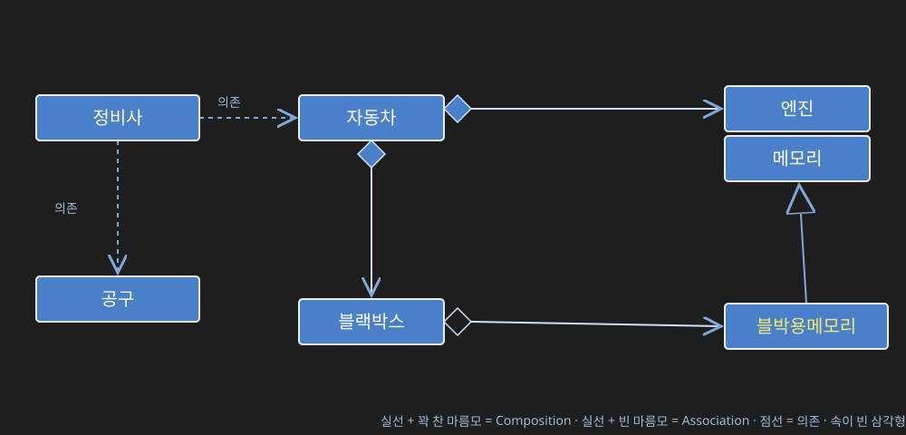

> 🔗 관련 노트: [[026_UI와 데이터의 분리, HAS-A 관계와 DI]] · [[027_패키지와 도메인 기반 네이밍]]

# 프로젝트 구성과 클래스패스, IS-A 상속의 등장

## 1. 두 종류의 프로젝트 — 애플리케이션 vs 라이브러리

지금까지 만든 프로젝트는 전부 **`main` 함수를 가진 애플리케이션**이었다. 사용자가 실행하면 그 `main`부터 시작해서 프로그램이 동작하는 구조다.

그런데 프로젝트에는 또 다른 종류가 있다 — **`main` 함수가 없는 프로젝트**다. `main`이 없다는 건 "누가 직접 실행하는 프로그램"이 아니라, **다른 프로젝트에서 갖다 쓰라고 만든 부품(라이브러리)**이라는 뜻이다.

`mathlib` 프로젝트가 이 두 번째 유형이다.

```java
package com.example.mathlib;

public class Calculator {
    public int add(int a, int b) {
        return a + b;
    }
    // ... 계산 관련 서비스 메서드
}
```

이 `Calculator`는 도메인 기반 패키지명(`com.example.mathlib`)을 쓰고 있고, `main`이 없다. 이 프로젝트를 그대로 실행할 수는 없고, 대신 **jar로 묶어서 다른 프로젝트가 라이브러리로 가져다 쓸 수 있게** 배포한다.

## 2. 프로젝트를 만든다는 것 자체는 별 게 아니다

VS Code(또는 어떤 도구든) 기준으로 "Java Project"로 자동 인식이 안 되면, **"프로젝트 만들기 → No build tool → 워크스페이스 선택 → 프로젝트명 입력"** 순서로 직접 만들면 된다. 프로젝트라는 게 특별한 무언가가 아니라, 소스 코드를 담을 폴더 하나가 있으면 그게 곧 프로젝트다.

## 3. 컴파일과 실행을 도구에게 맡긴다

지금까지는 `javac`, `java` 명령을 직접 입력해서 컴파일하고 실행했다. 하지만 VS Code 같은 도구를 쓰면, **Run 버튼 하나로 컴파일부터 실행까지 도구가 알아서 처리**해준다. 앞으로는 "어디에 `main`이 있는지 찾아서 그걸 컴파일하고 실행하는" 반복 작업을 직접 하지 않고, 도구가 대신하게 만드는 방향으로 간다.

## 4. 도구가 프로젝트를 이해하려면 정보가 필요하다 — settings.json

도구가 "알아서" 컴파일·실행해주려면, 그 전에 **프로젝트가 어떤 구조인지**를 도구에게 알려줘야 한다. 그 정보가 담기는 곳이 `.vscode/settings.json`이다.

```json
{
    "java.project.sourcePaths": ["src"],
    "java.project.outputPath": "bin",
    "java.project.referencedLibraries": [
        "lib/**/*.jar"
    ]
}
```

- `sourcePaths`: 내가 작성한 소스 코드가 어디 있는지 (지정을 다 지우면 프로젝트 루트를 소스 루트로 인식한다)
- `outputPath`: 컴파일된 `.class` 파일을 어디에 둘지
- `referencedLibraries`: 이 프로젝트가 사용하는 외부 jar 파일을 어느 폴더(`lib`)에서 찾을지

이 세 가지(실행 위치, 라이브러리 위치, 저장 시 자동 번역)를 지정해두면, 코드를 수정하고 저장하기만 해도 도구가 알아서 실시간으로 컴파일해준다.

## 5. 라이브러리를 못 찾는 에러 — 설정이 없으면 도구는 아무것도 모른다

다른 프로젝트(`mathlib`)가 만든 `Calculator`를 가져다 쓰려고 `import`했는데 "찾을 수 없다"는 에러가 나는 경우가 있다. 이건 문법이 틀려서가 아니라, **도구(VS Code)가 그 jar 파일이 어디 있는지 모르기 때문**이다.

```java
import com.example.mathlib.Calculator;

public class App {
    public static void main(String[] args) throws Exception {
        Calculator calc = new Calculator();
        System.out.println(calc.add(3, 4));
    }
}
```

`calc-app` 프로젝트의 `lib` 폴더에 `mathlib.jar`를 넣고, `settings.json`의 `referencedLibraries`에 `lib/**/*.jar`를 지정해줘야만 위 코드가 정상적으로 `Calculator`를 인식한다. **설정이 없으면 프로젝트 구조를 도구가 이해할 방법이 없어서, 라이브러리를 갖다 놔도 못 찾는다.**

같은 문제를 명령줄에서 직접 컴파일/실행할 때는 `--class-path`, `-classpath`, `-cp` 세 가지 옵션 중 하나로 라이브러리 위치를 지정해서 해결한다. VS Code의 `referencedLibraries` 설정은 결국 이 classpath 지정을 도구가 대신 해주는 것이다.

## 6. UML로 보는 관계 — 실선 vs 점선, 꽉 찬 마름모 vs 빈 마름모

애플리케이션이 어떤 부품을 쓰고 있는지 그림으로 표현할 때, 화살표가 향하는 쪽이 **부품**이고 화살표가 나오는 쪽이 그 부품을 이용하는 **제품**이다.

| 선의 종류 | 의미 |
|---|---|
| **실선(—)** | 멤버 속성으로 갖고 있음 (HAS-A 관계) |
| **점선(---)** | 멤버로 갖고 있지 않고, 함수 안에서 잠깐 임시로 사용만 함 (의존, Dependency) |

HAS-A 관계(실선)는 다시 두 가지로 나뉜다.

| 표기 | 관계 |
|---|---|
| **꽉 찬 마름모(◆)** | Composition Has-A — 생성자 안에서 직접 만들어서 갖는 것. 생과 사를 함께한다(부모가 사라지면 부품도 함께 사라짐) |
| **빈 마름모(◇)** | Association Has-A — 외부에서 만들어진 걸 받아서 쓰는 것 |

자동차를 예로 들면 이렇게 그릴 수 있다.



- `정비사`는 `자동차`를 점검할 때, `공구`를 수리할 때만 잠깐 갖다 쓸 뿐 멤버로 갖고 있지 않으므로 점선(의존)
- `자동차`는 `엔진`과 `블랙박스`를 생성자에서 직접 만들어 갖고 있으므로 꽉 찬 마름모(Composition) — 자동차가 폐차되면 엔진과 블랙박스도 함께 사라진다
- `블랙박스`는 `블박용메모리`를 외부에서 만들어진 걸 받아서 쓰므로 빈 마름모(Association) — 메모리만 따로 교체하는 것도 가능
- `블박용메모리`는 `메모리`를 상속받아 확장한 것이므로 속이 빈 삼각형(IS-A) — 바로 다음 절에서 다룰 관계

## 7. HAS-A만으로 부족할 때 — IS-A의 등장

앞서 6절 그림에 나왔던 `블랙박스`와 `메모리`로 이어서 비유하면 이해가 쉽다.

**방법 1 — 부품을 구매해서 조립한다(HAS-A)**

블랙박스에 넣을 메모리가 필요하면, 시중에 파는 범용 메모리를 사서 빈 마름모(Association Has-A)로 조립하면 된다. 이게 지금까지 다룬 HAS-A 관계다.

**문제 상황**: 그런데 블랙박스에는 "충격에 강하고 고온에서도 데이터가 안전한 차량용 메모리"가 필요한데, 시중에 파는 범용 메모리 중엔 그런 게 없다. 대신 **내가 원하는 것과 거의 비슷한 범용 메모리**는 존재한다. 그 메모리를 그대로 가져다 쓰기엔(HAS-A로 조립하기엔) 내구성 스펙이 부족하고, **확장하거나 수정**하고 싶은 상황이 생긴다.

이럴 때 필요한 게 **IS-A 상속**이다. 기존에 있는 것(부모)을 "그대로 가져와서 쓰는" HAS-A와 달리, IS-A는 "기존에 있는 것을 물려받되, 내가 필요한 걸 더 추가하거나 바꿔서" 새로운 것을 만드는 관계다.

```java
public class Exam {
    private int kor;
    private int eng;
    private int math;
    // getKor/setKor, total(), avg() 등
}

// Exam    : 부모 클래스, 기반 클래스, 기저 클래스, 상위 클래스
// NewExam : 자식 클래스, 확장 클래스, 파생 클래스, 하위 클래스
public class NewExam extends Exam {

    private int com;

    public int getCom() {
        return com;
    }

    public void setCom(int com) {
        this.com = com;
    }
}
```

`Exam`과 `NewExam`처럼 상속 관계에 있는 두 클래스를 부르는 이름은 하나로 고정되어 있지 않다. 부모 쪽은 **부모/기반/기저/상위** 클래스, 자식 쪽은 **자식/확장/파생/하위** 클래스라고 부르며, 문맥에 따라 섞어서 쓴다.

`NewExam`은 `Exam`을 완전히 새로 만든 게 아니라, **기존 `Exam`을 그대로 물려받은 뒤(IS-A) `com` 필드와 그 게터/세터만 추가로 확장**한 것이다. `ExamConsole`이 `NewExam`을 HAS-A로 갖게 되면, `NewExam`이 상속받은 `Exam`의 모든 서비스(`getKor()`, `total()` 등)까지 자연스럽게 함께 사용할 수 있다.

**실제 사용 — `App2`**

```java
NewExam exam = new NewExam();
exam.setKor(10);
exam.setEng(10);
exam.setMath(10);
exam.setCom(10);

int total = exam.total();
System.out.printf("total is %d\n", total);
```

`setKor()`/`setEng()`/`setMath()`/`total()`은 `NewExam`에 새로 작성한 코드가 하나도 없다 — 전부 부모 `Exam`이 이미 갖고 있던 서비스를 상속받아 그대로 쓰는 것이다. `setCom()`만 `NewExam`이 새로 추가한 서비스다.

여기서 한 가지 눈여겨볼 점: `total()`은 여전히 `Exam`에 정의된 그대로 `kor + eng + math`만 계산한다. `com`에 10을 넣어도 `total()` 결과에는 반영되지 않는다 — **상속은 부모의 코드를 그대로 물려받는 것이지, 자식이 추가한 필드를 부모 메서드가 알아서 참고해주는 게 아니다.** `com`까지 합산에 포함시키고 싶다면 `NewExam`에서 `total()`을 별도로 재정의(오버라이드)해야 한다.

## 8. 부품(Dependency)과 틀(Framework)

- **부품 = Dependency(의존성)**: 지금까지 다룬 HAS-A로 갖다 쓰는 대상
- **틀 = Framework**: 우리가 만드는 웹 애플리케이션이든 무엇이든, 대부분 어떤 프레임워크 위에서 구현된다

**주의할 점**: Framework는 Dependency의 반대 개념이 아니다. "부품이냐 틀이냐"로 서로 대립하는 게 아니라, **Framework도 결국 Dependency(의존성) 안에 속하는 한 종류**이고, 그 관계 역시 HAS-A 개념으로 이해하면 된다 — 내가 만든 클래스가 프레임워크가 제공하는 클래스를 HAS-A로 갖다 쓰는 형태라는 점에서는 다른 라이브러리 부품을 갖다 쓰는 것과 본질적으로 같다.

입문자에게 자바보다 JS/파이썬을 먼저 추천하는 이유도 여기에 있다. JS/파이썬은 객체지향을 몰라도 절차만 따라가면 동작하는 코드를 짤 수 있지만, 자바로 API를 제대로 쓰려면 지금까지 다룬 캡슐화·HAS-A·IS-A 같은 객체지향 개념을 다 알아야 하는 진입장벽이 있다.

## 🔗 관련 노트

- [[026_UI와 데이터의 분리, HAS-A 관계와 DI]]
- [[027_패키지와 도메인 기반 네이밍]]
